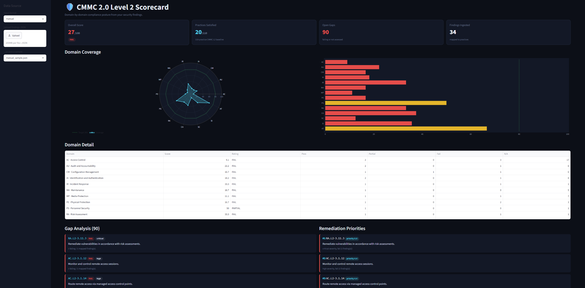
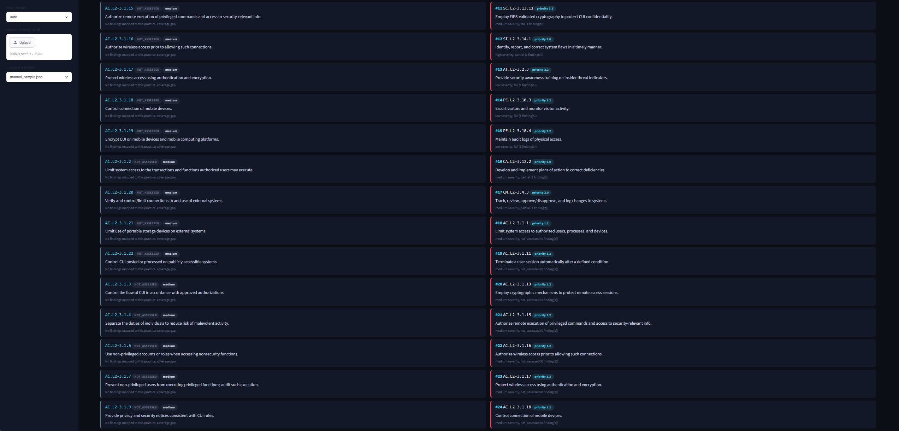
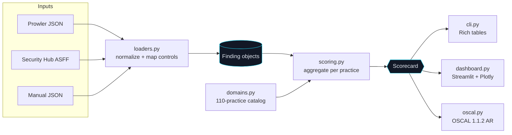

# 🛡️ cmmc-scorecard

> Turn raw security findings into a CMMC 2.0 Level 2 compliance scorecard — domain-by-domain ratings, gap analysis, remediation priorities, and OSCAL Assessment Results.

[](https://github.com/JulietRodriguez/cmmc-scorecard/actions/workflows/ci.yml)
[](https://www.python.org/)
[](LICENSE)
[](https://dodcio.defense.gov/CMMC/)
[](https://csrc.nist.gov/pubs/sp/800/171/r2/upd1/final)
[](https://pages.nist.gov/OSCAL/)
[](https://github.com/astral-sh/ruff)

`cmmc-scorecard` ingests a JSON findings file — from [Prowler](https://github.com/prowler-cloud/prowler), [AWS Security Hub](https://aws.amazon.com/security-hub/), or your own manual assessment — maps each finding onto the **110 practices across all 14 CMMC 2.0 Level 2 domains**, and produces:

- A **pass / partial / fail** rating per domain with a 0–100 coverage score.
- A prioritized **gap analysis** and **remediation ranking**.
- An **OSCAL 1.1.2 Assessment Results** export for GRC pipelines.
- A **dark, professional Streamlit dashboard** with a radar chart of domain coverage.
- A **Rich** terminal scorecard for CI and the command line.

---

## ✨ Features

| Capability | Description |
| --- | --- |
| **14-domain coverage** | Scores all CMMC 2.0 L2 domains: AC, AU, CM, IA, IR, MA, MP, PE, PS, RA, CA, SC, SI, AT. |
| **110-practice catalog** | Full NIST SP 800-171 r2 requirement catalog baked in — no external data files. |
| **Multi-source ingest** | Auto-detects Prowler native JSON, Security Hub ASFF, or the tool's manual schema. |
| **Smart control mapping** | Normalizes `3.1.1`, `AC.L2-3.1.1`, `NIST.800-171.r2 3.1.1`, etc. to canonical practice IDs. |
| **Pass/Partial/Fail logic** | Aggregates many findings per control; mixed results become `PARTIAL`. |
| **Gap analysis** | Surfaces every failing and not-assessed practice with severity and detail. |
| **Remediation ranking** | Prioritizes work by `severity × urgency × finding volume`. |
| **OSCAL 1.1.2 export** | Valid Assessment Results with findings, observations, and reviewed-controls. |
| **Rich CLI** | `score`, `gaps`, and `oscal` subcommands with color tables and JSON output. |
| **Streamlit dashboard** | Radar + bar charts, metric cards, gap cards, remediation board — dark security theme. |
| **Tested & linted** | 66-test `pytest` suite, `ruff` lint, GitHub Actions matrix (Python 3.10–3.13). |

---

## Screenshots

The dark, professional Streamlit dashboard turns a findings file into an at-a-glance compliance posture.

**Scorecard overview** — overall score, per-domain coverage, and the CMMC domain radar chart.



**Gap analysis & remediation** — failing and not-assessed practices alongside the prioritized remediation board.



---

## 🏗️ Architecture



**Data flow:** findings are normalized into `Finding` objects, each mapped to one or more canonical CMMC practice IDs. The scoring engine aggregates findings per practice (`PASS`/`FAIL`/`PARTIAL`/`NOT_ASSESSED`), rolls practices up into domain scores, derives gaps, and ranks remediation. The resulting immutable `Scorecard` is rendered by three independent presenters (CLI, dashboard, OSCAL).

---

## 🚀 Quickstart

```bash
# Install (core CLI only)
pip install -e .

# Install with the Streamlit dashboard
pip install -e ".[dashboard]"

# Score a findings file
cmmc-scorecard score samples/manual_sample.json

# Gap analysis + remediation priorities only
cmmc-scorecard gaps samples/prowler_sample.json

# Export OSCAL 1.1.2 Assessment Results
cmmc-scorecard oscal samples/securityhub_sample.json -o results.json

# Machine-readable summary for CI gates
cmmc-scorecard score samples/manual_sample.json --json
```

### Launch the dashboard

```bash
streamlit run cmmc_scorecard/dashboard.py
```

Upload a findings file or pick a bundled sample from the sidebar.

---

## 🖥️ CLI usage

```text
cmmc-scorecard <command> <findings.json> [options]

Commands
  score   Render the full scorecard (domains + gaps + remediation)
  gaps    Show gap analysis and remediation priorities
  oscal   Export OSCAL 1.1.2 Assessment Results

Common options
  --source {prowler,securityhub,manual}   Force input format (default: auto-detect)

score options
  --oscal PATH        Also write OSCAL results to PATH
  --json              Emit a JSON summary instead of tables
  --no-gaps           Show only the domain table
  --gap-limit N       Limit number of gaps displayed
  --rem-limit N       Limit number of remediation items (default 10)
```

Example terminal output:

```text
┌────────────────────────── cmmc-scorecard ──────────────────────────┐
│ CMMC 2.0 Level 2 Scorecard                                          │
│ Overall: 27.1/100  FAIL   Practices satisfied: 20/110               │
└─────────────────────────────────────────────────────────────────────┘
                            Domain Coverage
 Domain                         Score  Coverage     Rating   Breakdown
 AC · Access Control                9  #---------   FAIL     2/0/3/17
 PS · Personnel Security           50  #####-----   PARTIAL  1/0/0/1
 AT · Awareness and Training       67  #######---   PARTIAL  2/0/1/0
 ...
 Breakdown = pass / partial / fail / not-assessed
```

---

## 📥 Input formats

### Manual (the tool's native schema)

```json
{
  "findings": [
    {
      "id": "AC-002",
      "title": "Least privilege not enforced for admins",
      "status": "fail",
      "severity": "high",
      "control_ids": ["3.1.5"],
      "resource": "iam/role/ops-admin",
      "remediation": "Scope IAM policies to required actions."
    }
  ]
}
```

`status`: `pass` · `fail` · `partial` · `manual`. `severity`: `critical` · `high` · `medium` · `low` · `informational`. `control_ids` accept NIST 800-171 or CMMC practice IDs.

### Prowler

Native Prowler JSON whose `Compliance` block maps to NIST 800-171 / CMMC, e.g. `"Compliance": {"NIST-800-171-Revision-2": ["3.5.3"]}`.

### AWS Security Hub

ASFF findings (`{"Findings": [...]}`) using `Compliance.RelatedRequirements` such as `"NIST.800-171.r2 3.1.1"` and `Compliance.Status` of `PASSED` / `FAILED` / `WARNING`.

See [`samples/`](samples/) for a complete example of each.

---

## 📊 Scoring model

- **Control status** — `PASS` (all mapped findings pass), `FAIL` (all fail), `PARTIAL` (mixed or warning), `NOT_ASSESSED` (no mapped findings).
- **Control credit** — `PASS` = 1.0, `PARTIAL` = 0.5, otherwise 0.0.
- **Domain score** — mean control credit × 100 across every practice in the domain.
- **Rating** — `PASS` ≥ 80, `FAIL` < 50, otherwise `PARTIAL`.
- **Overall score** — equal-weighted mean of the 14 domain scores.
- **Remediation priority** — `severity_weight × status_urgency × (1 + min(findings, 10) × 0.1)`.

> ℹ️ Scores reflect **coverage of practices represented in your findings**, not a formal CMMC assessment. Not-assessed practices count against a domain so gaps stay visible.

---

## 🧪 Development

```bash
pip install -e ".[dev,dashboard]"
pytest                 # full suite (66 tests)
pytest --cov=cmmc_scorecard --cov-report=term-missing
ruff check cmmc_scorecard tests
```

### Project layout

```
cmmc_scorecard/
├── domains.py     # 110-practice CMMC L2 catalog + control-id normalization
├── models.py      # Finding, ControlResult, DomainScore, Gap, Scorecard
├── loaders.py     # Prowler / Security Hub / manual ingest + auto-detect
├── scoring.py     # aggregation, gap analysis, remediation ranking
├── oscal.py       # OSCAL 1.1.2 Assessment Results export
├── cli.py         # Rich CLI (score / gaps / oscal)
└── dashboard.py   # Streamlit dark-theme dashboard
samples/           # demo Prowler / Security Hub / manual findings
tests/             # pytest suite
```

---

## ⚠️ Disclaimer

`cmmc-scorecard` is an analysis aid, not an official CMMC assessment tool. Results depend entirely on the completeness and accuracy of the findings you feed it. Always validate against an authorized C3PAO assessment and the current [CMMC Assessment Guide](https://dodcio.defense.gov/CMMC/).

## 📄 License

[MIT](LICENSE)
